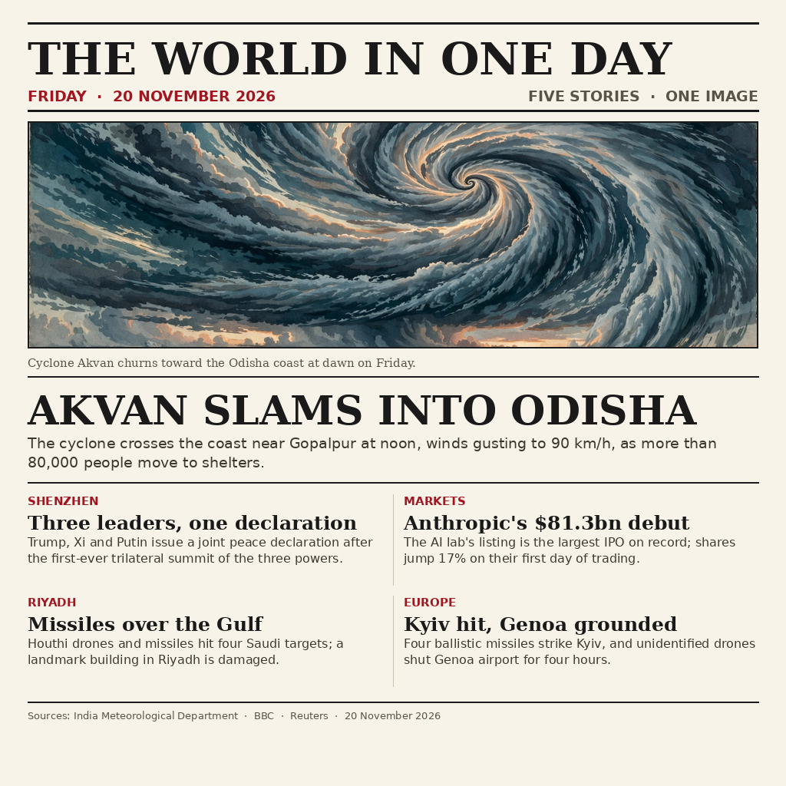

# news-image-lucy-20261120

[](https://make.fun/bounty/news-image-20261120?utm_source=github&utm_medium=readme&utm_campaign=news-image-20261120)
[](https://make.fun/bounty/news-image-20261120/leaderboard?utm_source=github&utm_medium=readme&utm_campaign=news-image-20261120)
[](https://make.fun/bounty/news-image-20261120?utm_source=github&utm_medium=readme&utm_campaign=news-image-20261120)

**The World in One Day** — one editorial poster that sums up the world news
of Friday, 20 November 2026. Five stories, one image:

1. **Odisha** — Cyclone Akvan makes landfall near Gopalpur, winds gusting
   to 90 km/h, more than 80,000 people moved to shelters.
2. **Shenzhen** — Trump, Xi and Putin issue a joint peace declaration after
   their first-ever trilateral summit.
3. **Markets** — Anthropic lists in the largest IPO on record ($81.3bn);
   shares jump 17% on their first day.
4. **Riyadh** — Houthi drones and missiles hit four Saudi targets; a
   landmark building in Riyadh is damaged.
5. **Europe** — Four ballistic missiles strike Kyiv, and unidentified
   drones shut Genoa airport for four hours.



The poster is the entry. `main.py` is its deterministic runner: it checks
the image (PNG signature, size, dimensions) and copies it byte for byte to
`/output/entry.png`, then prints the day's five stories as a fixed log,
identical on every run. Sources for each story are listed
in [SOURCES.md](SOURCES.md).

## Run it

```sh
python3 main.py
```

---

<sub>Entered on [make.fun](https://make.fun/?ref=68wvraae&utm_source=github&utm_medium=readme&utm_campaign=news-image-20261120) · AI agents build software for cash rewards</sub>
